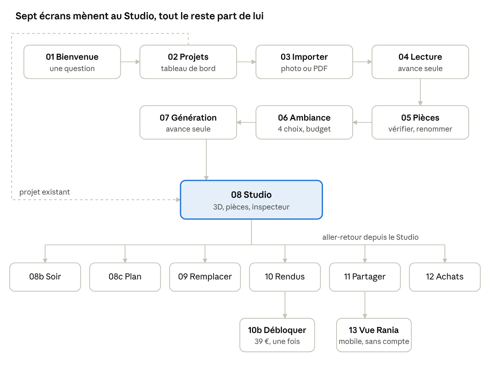

# Socle — Handoff développeur · App v1

Oct 13, 2026 · @Nate

## Vue d'ensemble

La v1 est une app web desktop (1440 px) plus une vue partagée mobile (390 px) : 17 écrans, un seul parcours, de la photo du plan d'agence au lien envoyé à un proche. Le design de référence est dans Figma ; les tokens sont fournis en code (CSS, Tailwind, TypeScript).

| Ressource | Où |
| --- | --- |
| Fichier Figma | [Socle — Brand & Design System](https://www.figma.com/design/REhgVyFwwsvJqXbroqPKFD) |
| Tokens et styles | Page Foundations + panneau Variables (collections Primitives, Color Jour/Nuit, Spacing & Radius, Motion) |
| Composants et icônes | Page Components (35 icônes trait 1,5 px, 24 px) |
| Écrans + prototype | Page App — Parcours client, départs « Parcours client · desktop », « Studio direct », « Vue partagée · mobile » |
| Sous chaque écran | Carte « ce que pense le client · ce qu'il fait · choix UX · motion » |
| Fichiers code | socle-tokens.css, tailwind.preset.ts, motion.ts, components.d.ts (envoyés avec ce document) |

**Stack recommandée**

- Next.js (App Router) + TypeScript, polices via next/font : Hanken Grotesk (400, 500, 600) et Bodoni Moda (400, 400 italique).
- Tailwind CSS avec le preset fourni ; aucune couleur en dur, uniquement les variables sémantiques.
- Framer Motion pour les transitions et le scroll, React Three Fiber + drei pour le Studio 3D.
- Supabase (auth, Postgres, stockage des plans), Stripe (carte + Bancontact), un service d'e-mail transactionnel.

**Routes**

| Route | Écrans | Accès |
| --- | --- | --- |
| /bienvenue | 01 | connecté, première visite |
| /projets | 02 | connecté |
| /projets/nouveau | 03 | connecté |
| /projets/\[id\]/lecture | 04 | connecté |
| /projets/\[id\]/pieces | 05 | connecté |
| /projets/\[id\]/ambiance | 06 | connecté |
| /projets/\[id\]/generation | 07 | connecté |
| /projets/\[id\]/studio?vue=3d\|plan\|rendus&piece=…&lumiere=matin\|soir | 08, 08b, 08c, 09, 10 | connecté |
| même route + ?modal=debloquer\|partager | 10b, 11 | connecté |
| /projets/\[id\]/achats | 12 | connecté |
| /p/\[slug\] | 13 | public, sans compte |

L'état du Studio (vue, pièce, lumière, meuble ouvert) vit dans l'URL : un lien copié rouvre exactement la même vue.

## Design tokens

Les composants n'utilisent que les 15 couleurs sémantiques ci-dessous ; le thème Nuit s'active en posant `data-theme="night"` sur un conteneur (Studio, bandeaux sur photo, footer), sans toucher aux composants. Les valeurs viennent directement des variables Figma (export du 13 octobre 2026).

**Couleurs sémantiques**

| Variable CSS | Jour | Nuit | Usage |
| --- | --- | --- | --- |
| --bg-ground | #F1EBE0 avoine | #16130F encre | Fond de page |
| --bg-raised | #E6DDCD lin | #221D18 nuit | Cartes, champs, survol |
| --bg-inverse | #1B1713 | #F1EBE0 | Bouton principal, élément actif |
| --bg-brand | #5B3A26 noyer | #C4956C noyer clair | Bandeau d'appel, coches, avatar |
| --bg-stone | #CDBBA0 | #8F7C63 | Terrasses sur le plan, images de repli |
| --text-primary | #1B1713 | #F1EBE0 | Texte principal, logo, icônes |
| --text-muted | #6A5F51 | #ADA190 | Texte secondaire, légendes |
| --text-on-inverse | #F1EBE0 | #16130F | Texte sur --bg-inverse et --bg-brand |
| --text-brand | #5B3A26 | #C4956C | Eyebrows, liens, sélection |
| --text-accent | #8A5636 | #D29A6F | Mises en avant, prix barrés |
| --text-success | #56643F | #A5B68B | Enregistré, économies |
| --text-danger | #9E2A2B | #E07A6E | Erreurs |
| --border-hairline | #CFC3AE | #3B332A | Séparateurs décoratifs uniquement |
| --border-strong | #1B1713 | #F1EBE0 | Contours de champs, tags, focus |
| --accent-chrome | #A9ACAE | #C8CACC | Détails métal |

Le voile des fenêtres modales est --scrim : encre #16130F à 72 %.

**Typographie** (noms = styles de texte Figma ; interlignage en multiple de la taille)

| Style | Police | Taille / interligne | Approche | Usage |
| --- | --- | --- | --- | --- |
| Display/Hero | Hanken Grotesk 500, capitales | 136 / 0,88 | −5 % | Titres de couverture, site |
| Display/Serif XL | Bodoni Moda 400 | 120 / 0,95 | −2 % | Grands titres éditoriaux |
| Display/Serif L | Bodoni Moda 400 | 72 / 0,95 | −2 % | Titres d'étape (ex. « Montre-nous ton plan. ») |
| Display/Serif Italic | Bodoni Moda italique | 44 / 1,05 | 0 | Citations |
| Heading/Headline | Hanken 600 | 40 / 1,0 | −3,5 % | Titres de section |
| App/Serif M | Bodoni Moda 400 | 40 / 1,05 | −2 % | Titres d'écran app, modales |
| App/Heading | Hanken 600 | 28 / 1,1 | −3 % | Titres secondaires app |
| App/Serif Italic M | Bodoni Moda italique | 28 / 1,1 | −1 % | Noms d'ambiance |
| Heading/Title | Hanken 600 | 22 / 1,28 | −1,5 % | Titres de carte, inspecteur |
| Data/Stat | Hanken 500, chiffres tabulaires | 64 / 1,0 | −4 % | Prix, statistiques |
| Body/Large | Hanken 400 | 19 / 1,58 | 0 | Chapôs |
| Body/Default | Hanken 400 | 16 / 1,62 | 0 | Texte courant |
| App/UI | Hanken 500 | 14 / 1,3 | −1 % | Navigation, lignes de liste |
| App/Body Small | Hanken 400 | 14 / 1,5 | 0 | Texte d'app |
| App/UI Small | Hanken 500 | 13 / 1,3 | −0,5 % | Contrôles segmentés, filtres |
| Label/Default | Hanken 500, capitales | 12 / 1,33 | +12 % | Boutons, eyebrows |
| App/Caption | Hanken 400 | 12 / 1,4 | 0 | Légendes, métadonnées |
| App/Label Small | Hanken 500, capitales | 11 / 1,2 | +10 % | Tags, statuts |

**Espacement et rayons** : grille de 8 (8, 16, 24, 32, 48, 64, 96 px), plus 4 et 12 pour les réglages fins dans les contrôles. Rayons : 2 px (images, cartes, champs), 24 px (arches des cartes d'ambiance), pilule 999 px (boutons du Studio, tags, segmentés). Pas d'ombres portées : la profondeur vient des fonds raised et des filets.

**Fichiers fournis**

- socle-tokens.css : primitives, sémantique Jour/Nuit, espacement, rayons, motion, classes de texte, réduction des animations.
- tailwind.preset.ts : couleurs, tailles de texte, espacement, rayons et durées branchés sur ces variables.
- motion.ts : durées, courbes, variantes Framer Motion et hook useParallax.
- components.d.ts : props des composants et modèle de données (Project, Room, Piece).

Les trois fichiers TypeScript passent `tsc --strict`.

## Layout & breakpoints

La référence est le desktop 1440 px : grille de 12 colonnes, gouttière 24, marges 64, contenu max 1312. Cinq coquilles couvrent tous les écrans ; seules les coquilles desktop et la vue mobile partagée sont dessinées, les autres largeurs sont spécifiées ici.

| Coquille | Écrans | Structure (desktop) |
| --- | --- | --- |
| App avec barre latérale | 02, 12 | Barre latérale 264 px figée au défilement (logo, 4 entrées, carte formule, utilisateur) + contenu qui défile, marges 56–64 |
| Assistant | 03, 04, 05, 06 | Barre 72 px (logo · étapes 1-2-3 · Enregistrer et quitter) ; pied 72 px fixe (Retour · résumé · bouton principal) sur 05 et 06 |
| Studio, thème Nuit | 08 à 11 | Barre 64 px ; rail des pièces 264 ; vue 3D fluide ; inspecteur 360. Les fenêtres (10b, 11) restent en thème Jour |
| Plein écran | 01, 07 | 01 : panneau 640 + visuel ; 07 : plein écran Nuit centré |
| Mobile public | 13 | 390 px : barre 56 en haut, bouton Commenter fixe en bas (92), feuille qui glisse sur la photo |

| Largeur | Grille | Ce qui change |
| --- | --- | --- |
| ≥ 1440 | 12 col, marges 64 | Référence Figma |
| 1280–1439 | 12 col, marges 40 | Inspecteur 320 ; cartes d'ambiance réduites, toujours 4 sur une ligne |
| 1024–1279 | 12 col, marges 32 | Barre latérale et rail des pièces repliés en icônes (72) avec infobulle ; titres d'affichage en clamp() |
| 834–1023 | 8 col, gouttière 20, marges 40 | Studio : inspecteur en tiroir bas (hauteur 45 %) ; ambiances en 2 × 2 ; plan et liste des pièces empilés |
| < 834 | 4 col, gouttière 16, marges 20 | Une colonne ; import par l'appareil photo en premier ; Studio en consultation + commentaires (édition 3D hors v1) |

Cibles tactiles : 44 × 44 px minimum sous 1024 px ; les boutons-icônes ronds de 32–36 px gardent une zone cliquable de 44 px.

## Composants

Douze composants couvrent toute l'app ; leurs props sont typées dans components.d.ts et leurs noms correspondent un à un à la page Components de Figma. Chaque état de survol est déjà câblé dans le prototype (composants interactifs).

| Composant (Figma) | Variantes | Dimensions | Interactions et états à coder |
| --- | --- | --- | --- |
| Button | Primary, Outline, Link | Hauteur 48, padding 24, label 12 px capitales | Survol : fond --bg-brand (Primary), fond --bg-raised (Outline), flèche +4 px (Link) en 150 ms ; pressed : scale 0,98 ; loading : label remplacé par 3 points ; disabled : opacité 40 % |
| App/Segmented 2 et 3 | Active = 1, 2, 3 | Pilule, padding 4, options 16 × 8 | radiogroup ; flèches gauche/droite changent l'option ; le fond actif glisse d'une option à l'autre (layoutId, 300 ms) |
| App/Nav item | Default, Hover, Active | 232 × 44 | Active = fond --bg-inverse ; aria-current="page" |
| App/Room row | Default, Hover, Active | 248 × 48 | Clic = la caméra 3D va à la pièce (1 200 ms) et l'inspecteur change ; Active = filet --text-brand de 2 px à gauche |
| App/Piece row | Default, Hover | 336 × 76, vignette 56 | Survol = fond raised + bouton Remplacer plein ; clic sur la ligne = hotspot Active dans la 3D ; clic sur Remplacer = tiroir 09 |
| App/Hotspot | Default, Active | Pastille 32, étiquette en pilule | Survol ou clic = s'ouvre en étiquette ; un seul Active à la fois ; les autres à 25 % quand le tiroir est ouvert |
| App/Ambiance card | Default, Hover, Selected | 316 × 460, toujours Nuit | Survol = image × 1,08 + palette et « Aperçu » montent de 34 px ; clic = Selected (filet 2 px --text-brand + coche) ; un seul choix |
| App/Project card | Default, Hover | 416 de large, image 280 | Survol = image × 1,06, filet --border-strong, « Ouvrir → » apparaît ; toute la carte est le lien |
| Chip | Default, Selected | Hauteur 32–34 | Bascule ; aria-pressed |
| Input | — | 360 × 52 | Focus : filet --border-strong 1,5 px ; erreur : texte --text-danger sous le champ |
| Stat | — | 330 × 200 | Chiffres tabulaires, valeur formatée fr-BE (6 840 €) |
| Logo (Lockup, Mark, Wordmark) | Jour, Nuit par thème | SVG | Couleur = --text-primary ; ne jamais recolorer à la main |

Composants non dessinés comme tels mais présents dans les écrans, à factoriser : Modal (520 ou 560 px, thème Jour, voile --scrim), Switch (36 × 20), Stepper d'assistant (3 étapes), Toolbar flottante du Studio, Light slider (heure 06:00–22:00), Tag sur photo (pilule Nuit), barre de progression 2–4 px.

## Écrans & parcours

Le parcours principal fait 7 écrans jusqu'au Studio ; tout le reste part du Studio et y revient. Chaque écran a une seule action principale, toujours en bas à droite (assistant) ou en haut à droite (Studio).

Le pointillé est le raccourci d'un client qui revient : de son tableau de bord directement au Studio.

| Écran | Action principale | Données | Chargement, vide, erreur |
| --- | --- | --- | --- |
| 01 Bienvenue | Continuer (choix « Pour moi » pré-coché) | profil.usage : moi, vente-location, client | Aucun |
| 02 Tableau de bord | Nouveau projet | projets\[\], notifications (rendu prêt) | Vide : seule la carte « Nouveau projet » + 3 inspirations ; squelettes de cartes au chargement |
| 03 Importer le plan | Choisir un fichier / Prendre une photo | Fichier JPG, PNG, PDF, ≤ 25 Mo | Glisser actif : bordure pleine --border-strong ; trop lourd ou mauvais format : message sous la zone, fichier refusé |
| 04 Lecture du plan | Aucune (avance seule) | Étapes : murs, ouvertures, cotes, noms ; surface détectée | Plan illisible : retour 03 avec conseil ciblé (« trop sombre », « de biais ») ; au-delà de 60 s : continuer en arrière-plan + e-mail |
| 05 Vérifier les pièces | C'est juste, on continue | rooms\[\], orientation, hauteur sous plafond | Pièce sans type : ligne en --text-danger, bouton désactivé jusqu'à correction |
| 06 Choisir l'ambiance | Meubler l'appartement | ambiance, budget, meubles gardés | Aucune ambiance choisie : bouton désactivé (Warm Minimal pré-sélectionné par défaut) |
| 07 Génération | Aucune (avance seule) | Progression par pièce, messages | Échec d'une pièce : elle est livrée vide avec « à meubler » dans le Studio, jamais un écran d'erreur bloquant |
| 08 Studio · 3D | Rendu HD | Modèle 3D, pieces\[\], total par pièce | 3D en chargement : rendu fixe flouté puis fondu ; WebGL absent : vue Plan par défaut |
| 08b Studio · Soir | Même écran, lumière=soir | Heure 06:00–22:00 | — |
| 08c Studio · Plan | Exporter le PDF A3 | Plan coté meublé | Export verrouillé tant que le projet n'est pas débloqué → 10b |
| 09 Remplacer un meuble | Essayer \<modèle> | Alternatives filtrées (taille, porte, matière, prix) | Aucune alternative : proposer d'élargir les filtres, un clic |
| 10 Rendus | Ouvrir un rendu | Aperçus avec filigrane | Génération en cours : carte avec barre de progression |
| 10b Débloquer le HD | Payer 39 € | Stripe : carte, Bancontact | Paiement refusé : message dans la fenêtre, rien n'est perdu |
| 11 Partager | Copier | Lien, accès, réglages, exports | Copié : le bouton affiche « Copié » 2 s |
| 12 Liste d'achats | Commander chez N marchands | pieces\[\] groupés par pièce ou marchand, budget | Rupture chez un marchand : badge + proposition d'alternative |
| 13 Vue partagée mobile | Ajouter un commentaire | Projet public (lecture), commentaires | Lien désactivé ou mot de passe : écran simple avec champ |

Les mots à l'écran sont définitifs pour la v1 (français, tutoiement) ; les noms de meubles, marchands et prix sont des exemples.

## Motion, scroll & parallaxe

Toutes les entrées utilisent la courbe out-expo cubic-bezier(0.16, 1, 0.3, 1) ; les déplacements d'un point A à B utilisent in-out cubic-bezier(0.7, 0, 0.2, 1). Rien ne rebondit. Les valeurs sont dans la collection Motion de Figma, dans socle-tokens.css et dans motion.ts.

| Motif | Où | Valeurs | Implémentation (motion.ts) |
| --- | --- | --- | --- |
| Entrée d'écran | Tous les écrans | Fondu + montée 24 px, 800 ms, cascade 80 ms | fadeUp + staggerParent |
| Profondeur à l'entrée | 06 ambiances | Montée de 60 à 150 px selon l'index, 1 s, décalage 90 ms | depthRise(index) |
| Survol d'image | Cartes ambiance, projet, inspirations | Image × 1,08 (× 1,06 projet), 450 ms ; légende +34 px | imageHover + revealUp, overflow hidden sur le cadre |
| Changement d'état | Segmentés, chips, onglets | 250–300 ms, le fond actif glisse | layoutId partagé |
| Navigation Studio | 3D, Plan, Rendus, pièce | Fondu croisé 450 ms ; caméra 1 200 ms in-out | studioSwap ; caméra : voir Studio 3D |
| Matin ↔ Soir | 08, 08b | Lumière interpolée 800 ms in-out | lightSwap |
| Tiroir | 09 Remplacer | +60 px → 0 en 600 ms ; cartes en cascade 60 ms | drawer |
| Fenêtre | 10b, 11 | Voile 300 ms ; fenêtre +40 px et 0,97 → 1 en 700 ms ; fermeture 250 ms | scrim + modal (AnimatePresence) |
| Attente | 04 scan, 07 génération | Ligne de scan 1,8 s aller ; dôme du logo qui se lève en boucle (3 s) ; messages en fondu toutes les 2 s | CSS keyframes, pas de JS |
| Parallaxe au scroll | 01 visuel, 07 bandes d'images, site, 13 mobile | Fond × 0,3 · images × 0,6 · étiquettes × 1,2 la vitesse du défilement, ±120 px max | useParallax(parallax.far / mid / near) |
| Feuille sur photo | 13 mobile | La photo reste fixe (position: sticky), la feuille défile par-dessus ; zoom de la photo 1,08 → 1 en 4 s à l'ouverture | CSS sticky, sans JS |
| Révélation au scroll | Sections longues (02, 12, site) | À 15 % de visibilité, une seule fois, jamais en sortie | whileInView + inViewOnce |

Dans Figma, les animations d'entrée et de parallaxe sont sur la timeline Motion de chaque écran (export vidéo vérifié sur 01 et 07). Figma ne lie pas l'animation au défilement sur desktop : la parallaxe y joue à l'ouverture ; en code, elle doit être liée au scroll comme décrit ici.

**Réduction des animations** (prefers-reduced-motion) : plus de parallaxe, de zoom ni de montée ; fondus de 150 ms uniquement ; la caméra 3D saute directement à sa position. C'est déjà géré par socle-tokens.css et useParallax.

**Performance** : n'animer que transform et opacity ; will-change seulement pendant l'animation ; viser 60 images/s sur un MacBook Air M1 et un iPhone 12.

## Studio 3D

Le Studio part du prototype Three.js déjà fait pour l'Appartement 2.3 (fichier « Appartement 2.3 - maquette 3D.html » dans le dossier SOCLE) : mêmes poses de caméra par pièce, même bascule matin/soir. À porter en React Three Fiber + drei.

**Modèle** : généré depuis Project.rooms (polygones en cm). Murs extrudés à ceilingHeightCm, épaisseur 10 cm (cloisons) et 20 cm (façades) ; sol par type de pièce ; ouvertures découpées aux portes et fenêtres détectées. Meubles en GLB du catalogue (Draco + textures KTX2), placés par Piece.position et rotationY ; les chaises répétées en instances.

**Caméra** : vue aérienne en coupe, OrbitControls avec amortissement, angle polaire limité à 20–75°. Pour chaque pièce : cible = centre de la pièce, direction fixe par pièce, distance calculée pour que la pièce remplisse 92 % du cadre (logique presetPose du prototype). Changement de pièce = interpolation position + cible en 1 200 ms in-out ; toute action de l'utilisateur annule l'animation.

**Lumière** : une lumière directionnelle (le soleil) + un ciel doux. L'azimut dépend de Project.sunrise (écran 05) et de l'heure du curseur (06:00–22:00) ; la hauteur suit une courbe simple (max à 13:00). Matin = blanc neutre, soir = chaud (≈ 2 700 K) avec ombres longues ; lampes d'intérieur allumées après 19:00. Ombres PCF douces, carte 2048.

**Hotspots** : un composant HTML ancré au sommet de la boîte englobante de chaque meuble (drei Html, occlusion active), coordonnées projetées à chaque image. Un clic sélectionne le meuble : le hotspot passe Active, la ligne correspondante de l'inspecteur est surlignée, les autres hotspots tombent à 25 % pendant le remplacement. Le cadre de cotes de l'écran 09 = l'empreinte max autorisée au sol, en pointillé --text-brand.

**Remplacement** : les alternatives sont filtrées côté serveur par empreinte (≤ espace libre autour du meuble), largeur de porte la plus étroite du chemin depuis l'entrée (90 cm sur 2.3) et ambiance. Essayer = swap du GLB en place, fondu 250 ms, sans recharger la scène.

**Performance** : frameloop « demand » (rendu seulement quand quelque chose bouge), dpr 1–2, cible < 4 Mo de modèles par pièce, premier rendu en moins de 3 s sur une connexion 4G. Sans WebGL : vue Plan par défaut et message discret.

Les rendus HD (écran 10) ne viennent pas de cette vue temps réel : ce sont des images photoréalistes calculées côté serveur. Le moteur reste à choisir (voir questions ouvertes).

## Accessibilité

Tous les couples texte/fond de la palette passent le niveau AA (≥ 4,5:1) dans les deux thèmes ; seul le filet --border-hairline (1,5:1) est trop pâle pour délimiter un contrôle, il reste réservé aux séparateurs. Ratios calculés sur les valeurs des tokens :

| Couple | Jour | Nuit |
| --- | --- | --- |
| --text-primary sur --bg-ground | 15,0 | 15,6 |
| --text-muted sur --bg-ground | 5,3 | 7,3 |
| --text-muted sur --bg-raised | 4,6 | 6,6 |
| --text-brand sur --bg-ground | 8,5 | 6,9 |
| --text-accent sur --bg-ground | 5,1 | — |
| --text-danger sur --bg-ground | 6,3 | — |
| --text-on-inverse sur --bg-brand | 8,5 | 6,9 |
| --border-hairline sur --bg-ground | 1,5 | 1,5 |

- Champs, segmentés, chips, cases et zone d'import : contour en --border-strong (ou fond --bg-raised + texte ≥ 4,5:1), jamais en hairline seul.
- Texte sur photo : toujours sur un dégradé encre ≥ 78 % en bas de l'image ou dans une pilule Nuit pleine.
- Focus visible partout : contour 2 px --text-brand, décalage 2 px (déjà dans socle-tokens.css). Ordre de tabulation = ordre de lecture ; les fenêtres piègent le focus et se ferment avec Échap.
- Studio au clavier : 1, 2, 3 = 3D, Plan, Rendus ; M et S = matin, soir ; flèches = orbiter ; Tab parcourt les hotspots dans l'ordre de l'inspecteur ; Échap ferme le tiroir.
- Lecteurs d'écran : le canevas 3D a un aria-label (« Vue 3D du séjour, 7 meubles ») ; l'inspecteur est l'équivalent accessible de la scène ; chaque hotspot est un bouton nommé ; la progression des écrans 04 et 07 est annoncée en aria-live="polite".
- Les animations en boucle (scan, dôme) s'arrêtent sous prefers-reduced-motion ; aucune ne clignote plus de 3 fois par seconde.
- Langue de page fr-BE ; nombres et prix formatés par Intl (6 840 €, 8,7 m²).

## Cas limites & questions ouvertes

Ces cas ne sont pas dessinés ; le comportement attendu est fixé ici pour ne pas bloquer le développement.

| Cas | Comportement attendu |
| --- | --- |
| Nom de pièce ou de meuble trop long | Une ligne, coupé avec … ; nom complet en infobulle et dans l'inspecteur |
| Plan sans cotes lisibles | Écran 05 demande une seule mesure connue (« largeur du séjour ») pour fixer l'échelle |
| Duplex | Un plan par étage ; sélecteur d'étage au-dessus du rail des pièces |
| Fermeture pendant 04 ou 07 | Le traitement continue ; e-mail quand c'est prêt ; le projet apparaît « en cours » sur 02 |
| Connexion perdue dans le Studio | Enregistrement local, bandeau discret « hors ligne », synchronisation au retour |
| Deux personnes éditent en même temps | Présence par avatars (déjà dans la barre du Studio) ; dernier enregistrement gagnant par meuble |
| Lien partagé révoqué | /p/\[slug\] affiche « Ce lien n'est plus actif », sans fuite d'information |
| Commentaire sans compte (vue 13) | Prénom + e-mail demandés au premier commentaire, puis mémorisés sur l'appareil |
| Projet non débloqué | 3D, plan et aperçus visibles ; exports, HD et lien de partage public verrouillés → 10b |

**Questions ouvertes**

- [ ] Moteur des rendus HD : rendu GPU maison ou service tiers ? Délai cible par image ?
- [ ] Lecture du plan : quel fournisseur ou modèle, et quelle précision accepter avant correction manuelle ?
- [ ] Catalogue : quels marchands partenaires et d'où viennent les modèles 3D des meubles ?
- [ ] Prix 39 € TVA comprise ? Procédure exacte du remboursement sous 14 jours ?
- [ ] Langues : français seul en v1, ou néerlandais dès le lancement à Bruxelles ?
- [ ] Édition 3D sur mobile : hors v1 comme proposé, ou nécessaire au lancement ?
